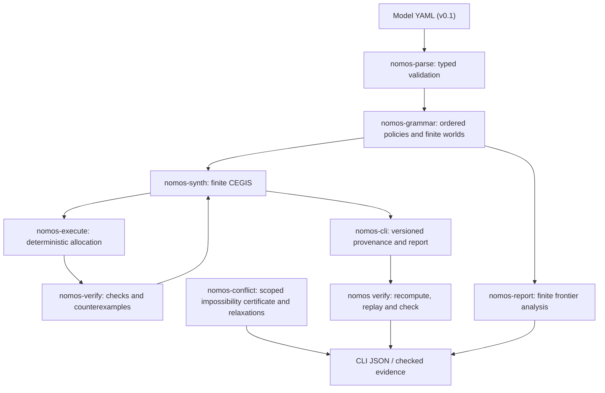

# NomosForge architecture

NomosForge is a **Rust 2021 workspace with nine crates**, organized around a deliberately bounded allocation model. The CLI accepts operator-provided YAML/JSON fixtures and prints JSON evidence or human-readable verification outcomes. It does not connect to a live institutional decision system.

| Component | Public surface | Boundary |
| --- | --- | --- |
| `nomos-cli` | `nomos` command, report JSON, exit codes | Routes operations and checks provenance; not a long-running service |
| `nomos-parse`, `nomos-grammar` | Typed v0.1 model and candidate set | Finite input bounds, no general-purpose policy language |
| `nomos-types`, `nomos-execute` | Typed world/policy and allocation checks | Deterministic finite integer-token allocation |
| `nomos-synth`, `nomos-verify` | CEGIS report and replay | Exhaustive only for enumerated worlds and grammar |
| `nomos-conflict` | Conflict certificate, relaxations | Two-agent indivisible-token impossibility under declared assumptions |
| `nomos-report` | Bounded Pareto/frontier report | Descriptive finite-model comparisons, no external welfare ranking |

## Integrity and independent verification

The CLI's synthesis report includes hashes for the parsed model, ordered grammar, enumerated worlds, and transcript. `nomos verify --full-domain` recomputes the bounded result; hashes are not signatures. The independent `reference/nomosforge_reference.py` reference and `reference/compare_rust.py` compare the 20,736 policy/state outcomes in the committed reference fixture.

- [Try the quickstart](../README.md#quickstart-from-a-fresh-clone)
- [Review evidence scope](proof-boundaries.md)
- [Reproduce the reference study](reproducibility.md)
- [Contribute](../CONTRIBUTING.md)

A passing finite-model check does not establish social legitimacy, wider logical completeness, production security, or performance superiority.
